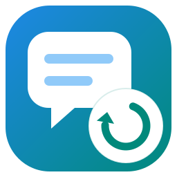
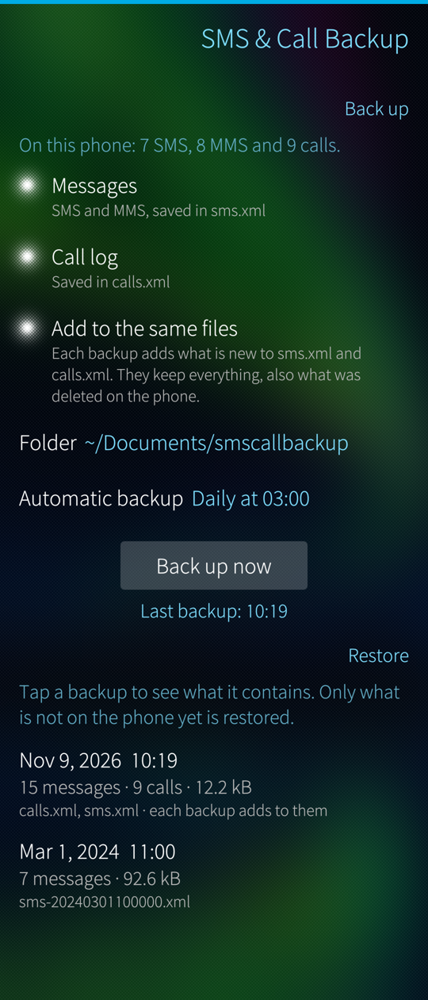
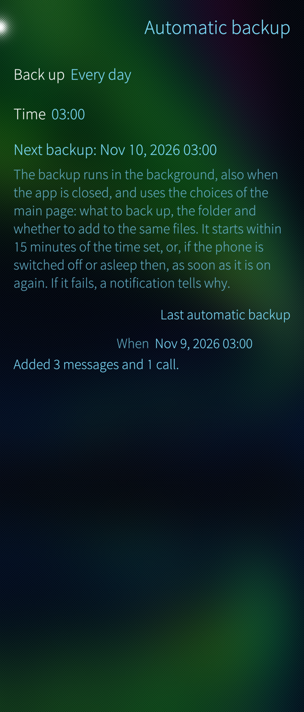
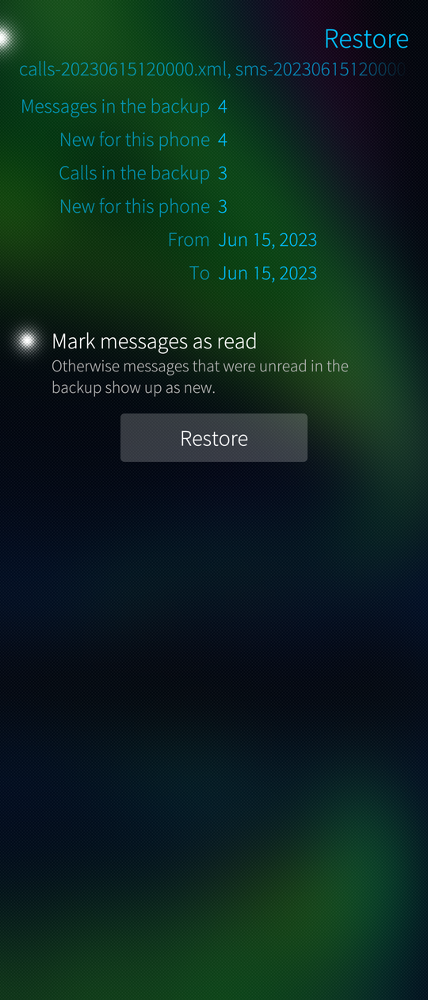
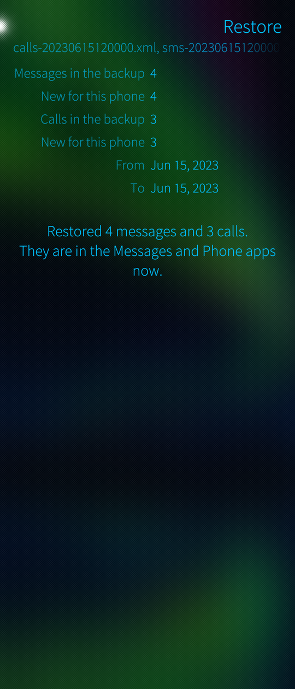

<!-- SPDX-FileCopyrightText: 2026 Johannes Meyer zum Alten Borgloh -->
<!-- SPDX-License-Identifier: MIT -->

# SMS & Call Backup for Sailfish OS

Backs up the SMS and MMS messages and the call log of a Sailfish OS phone into XML files in
the format of the Android app [SMS Backup & Restore](https://www.synctech.com.au/sms-backup-restore/),
and restores such files, including the RCS chats in Android backups. Your history can move
between Android and Sailfish OS in both directions, and you can keep a copy of it anywhere,
by hand or automatically.



   

## Features

* **Backup** of SMS, MMS (with their pictures and other attachments) and the call log,
  laid out like the files of the Android app, so SMS Backup & Restore can restore them on
  Android and its [online viewer](https://synctech.com.au/view-backup/) can show them.
  * **Incremental** (default): each backup adds what is new to `sms.xml` and `calls.xml`
    (the "archive" files of the Android app). They keep everything, also messages and
    calls that were deleted on the phone since. Files from the Android app's archive mode
    can be continued.
  * Or **new files** each time: `sms-<date>.xml` and `calls-<date>.xml` with everything
    that is on the phone.
  * **Automatic backups** every day, week or month at a set time, also when the app is
    closed (a systemd user timer). A notification tells when one fails.
* **Restore** of backups made by SMS Backup & Restore on Android (also compressed
  `.xml.zip` backups) or by this app:
  * Shows what is in the backup and what of it is new before anything is changed.
  * Adds only what is not on the phone yet. Restoring the same backup twice does no harm.
  * Messages go into the existing conversations of the Messages app (numbers compare like
    the phone does it, so `0176…` and `+49176…` are the same person), calls into the call
    log of the Phone app. Both apps show them at once, nothing needs a restart.
  * MMS come back with their attachments, stored like the MMS the phone receives itself.
    Group messages go into one conversation with all its members.
  * RCS chats (which Google Messages keeps as MMS in the backup), including group chats
    and business chats, are restored as messages.
  * Missed, rejected and blocked calls and private numbers are kept apart as on Android.
  * Old messages are restored as read (can be switched off).
  * On dual-SIM phones you choose the SIM the history belongs to.
* **Command line** for scripts.
* Runs in the Sailjail sandbox with few permissions: communication history, Documents,
  Downloads and memory cards. No network access, no access to contacts.

See [docs/FORMAT.md](docs/FORMAT.md) for how every field is mapped.

Contact names: the Android app writes the contact's name next to each number
(`contact_name`). Restoring does not need it, and Android looks names up itself. On Sailfish
OS the contacts database is privileged data that a sandboxed third-party app cannot read,
so backups made with the app write `(Unknown)` there. The command line adds names when it
runs with access to the contacts database, e.g. in a `devel-su -p` shell.

## Installation

From [SailfishOS:Chum](https://sailfishos-chum.github.io/) (once published there):
search for "SMS & Call Backup" in the Chum GUI app, or `devel-su pkcon install smscallbackup`.

Built for Sailfish OS 4.5 and newer; tested on Sailfish OS 5.2 on a Sony Xperia 10 VI.
When the app starts for the first time, Sailfish OS asks to allow its permissions.

## Moving from Android to Sailfish OS

1. In SMS Backup & Restore on Android, make a backup of messages and calls to local
   storage ("Back up now", local backup). It writes `sms-….xml` and `calls-….xml` into the
   `SMSBackupRestore` folder.
2. Copy both files to the phone, e.g. over USB into **Documents/smscallbackup** (the app's
   default folder) or anywhere in Documents or Downloads.
3. Open SMS & Call Backup. The backup shows up under "Restore"; files elsewhere can be
   picked with **Restore from files** in the pull-down menu.
4. Tap the backup, check the summary and tap **Restore**.

## Moving from Sailfish OS to Android

1. Tap **Back up now**. The files land in Documents/smscallbackup (`sms.xml` and
   `calls.xml`, or `sms-<date>.xml` and `calls-<date>.xml`).
2. Copy them to the Android phone, into the `SMSBackupRestore` folder, and restore them
   with SMS Backup & Restore ("Restore", local backup).

## Command line

Run as the normal user (not as root), e.g. in the Terminal app. The command line runs
outside the sandbox (Sailjail only starts the app's plain command), with the user's
normal access rights:

```sh
smscallbackup --backup                  # to the folder set in the app
smscallbackup --backup ~/Documents/old  # to another folder
smscallbackup --info sms-20261108120000.xml
smscallbackup --restore sms-20261108120000.xml calls-20261108120000.xml --dry-run
smscallbackup --restore sms-20261108120000.xml calls-20261108120000.xml --sim 2
smscallbackup --help
```

`--backup` adds to `sms.xml` and `calls.xml` or writes new files as set in the app;
`--incremental` and `--new-files` choose explicitly. `smscallbackup --scheduled` makes the
automatic backup if one is due (`--force`: now); the app's systemd user timer
`smscallbackup-scheduled.timer` runs it every 15 minutes while automatic backups are on.

## How it works

The communication history lives in libcommhistory's database
(`~/.local/share/commhistory/commhistory.db`). Backups read it with a read-only SQLite
connection. Restores write through libcommhistory itself, the library the Messages app,
the Phone app and commhistoryd use: it stores the entries exactly like the phone does and
announces them on D-Bus, so all apps update immediately. Details are in
[docs/FORMAT.md](docs/FORMAT.md).

## Publishing

See [docs/CHUM.md](docs/CHUM.md) for building on the Sailfish OS OBS and submitting to
SailfishOS:Chum.

## Building

With the [Sailfish SDK](https://docs.sailfishos.org/Tools/Sailfish_SDK/) (needs
`libcommhistory-qt5-devel` in the build target, mb2 installs it from the spec file):

```sh
mb2 -t SailfishOS-5.1.0.11-aarch64 build
```

The backup format code (`src/core`) only needs Qt Core and zlib. Its unit tests run on a
PC with Qt 5 or Qt 6:

```sh
mkdir build-tests && cd build-tests
qmake6 ../tests/tests.pro && make && ./tst_core
```

Translations live in `translations/`; they are updated by the build (`lupdate`).

## License

MIT, see [LICENSE](LICENSE). Copyright © 2026 Johannes Meyer zum Alten Borgloh.

SMS & Call Backup is not affiliated with SyncTech Pty Ltd, the maker of SMS Backup &
Restore. It only uses the file format, which SyncTech documents publicly.
